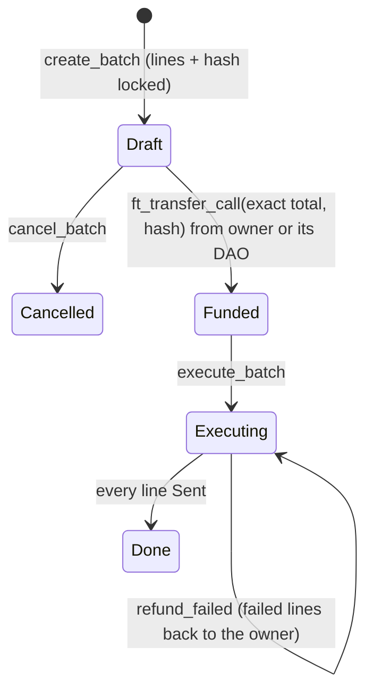
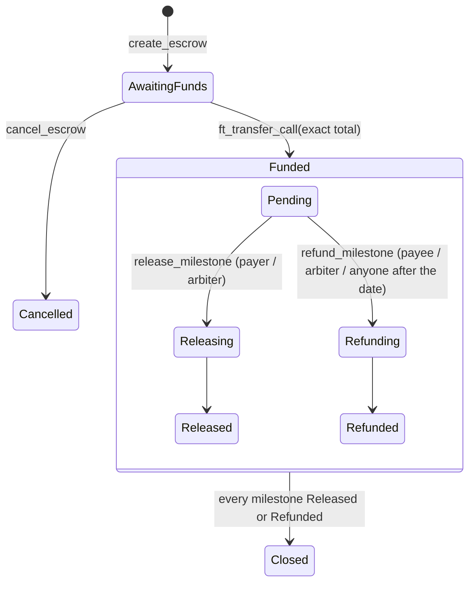

# Contract reference

Two Rust contracts (near-sdk 5.29.1). Source: `contracts/app` and `contracts/factory`. The prebuilt wasm files and their checksums are in `contracts/res` (`SHA256SUMS`).

| Contract | Testnet | Role |
| --- | --- | --- |
| `cascade_app.wasm` (428,757 bytes) | `app.cascade-tim.testnet` | Receipts, payout batches, revenue splits, milestone escrow, agent allowances. Deployed **locked**: no access keys, so nobody can upgrade it or move its funds |
| `cascade_factory.wasm` | `cascade-tim.testnet` | Creates named accounts (`ada.cascade-tim.testnet`) with an optional limited app key and USDC storage registered |

## Money in: one entry point

Every deposit is a NEP-141 `ft_transfer_call` to the app contract. `ft_on_transfer` reads `msg` and either accepts the exact amount or returns all of it:

| `msg` | Accepted when | Effect |
| --- | --- | --- |
| `{"batch_id", "hash"}` | From the configured USDC token, from the batch's owner (or its DAO), for exactly the batch total, with a matching hash | The batch becomes `Funded` |
| `{"split": id}` | From USDC, for a split that exists | Divided across the split's shares on arrival (a revenue split; 1Click delivers here with `customRecipientMsg`) |
| `{"escrow": id}` | From USDC, for exactly the escrow total, while `AwaitingFunds` | The escrow becomes `Funded` |
| `{"allowance": agent}` | From USDC, for an active allowance the sender set | Added to that agent's balance |
| anything else | never | Returned in full |

## Methods

### Owners and receipts

| Method | Who may call | Does |
| --- | --- | --- |
| `register_owner(kind, preparers)` | Anyone, for itself | Registers the caller as a person or a DAO. A DAO calls this through its own Sputnik `FunctionCall` proposal, so its members approve its preparers (max 10) |
| `create_invoice(owner, amount, metadata_hash)` / `void_invoice(id)` | Owner or preparer | On-chain invoice record |
| `mark_invoice_paid(id, deposit_address, amount_out, dest_tx)` | Settler only | Records that 1Click delivered at least the amount. Moves no money |
| `record_link_payment(owner, deposit_address, amount_out, dest_tx, metadata_hash)` | Settler only | The receipt for a checkout or link payment; `metadata_hash` binds it to the order |
| `is_deposit_recorded(deposit_address)` | View | Each deposit address can be recorded once |

### Payout batches (payroll, refunds)

| Method | Who may call | Does |
| --- | --- | --- |
| `create_batch(owner, lines)` | Owner or preparer | Locks up to 50 lines and returns the id and the hash the funder must quote |
| `set_batch_proposal(id, proposal_id)` | Owner or preparer | Links the batch to the DAO proposal that funds it (informational) |
| `cancel_batch(id)` | Owner or preparer | Before funding only |
| `execute_batch(id, limit)` | Anyone | Pays up to 8 queued lines per call (`storage_deposit` + `ft_transfer`); a line in flight can never be sent twice |
| `refund_failed(id)` | Anyone | Returns failed lines' money to the batch owner |
| `get_batch(id)`, `get_lines(id, from, limit)` | View | |

Line states: `Queued → InFlight → Sent`, or `InFlight → Failed → Refunding → Refunded`. At all times, sent + refunded + queued equals the batch total; this invariant is tested by random walks (`invariant_holds_under_random_walks`).

### Revenue splits

| Method | Who may call | Does |
| --- | --- | --- |
| `create_split(owner, shares)` | Owner or preparer | Up to 10 shares in basis points, summing to 10,000. A share can be a DAO |
| `get_split(id)` | View | |

### Milestone escrow

| Method | Who may call | Does |
| --- | --- | --- |
| `create_escrow(payee, payer, arbiter, milestones, refund_after_ms, metadata_hash)` | Payee, payer, or a preparer of an owner payee | Up to 20 milestones (titles up to 100 bytes); refund date up to 365 days out |
| `cancel_escrow(id)` | Payee or payer | Before funding only |
| `release_milestone(id, idx)` | **Payer or arbiter only** | Pays that milestone to the payee |
| `refund_milestone(id, idx)` | Payee or arbiter; **anyone** after the refund date | Returns that milestone to the payer |
| `get_escrow(id)`, `get_escrows_for(account)` | View | |

A failed transfer callback puts the milestone back to `Pending`; money can only ever go to the payee (release) or the payer (refund).

### Agent allowances

| Method | Who may call | Does |
| --- | --- | --- |
| `set_allowance(agent, policy, purpose)` | The owner, for itself | `policy = {per_payment_max, daily_max, expires_at_ms, payees[]}` (empty payees means any recipient, max 20). `purpose` (up to 140 bytes) is the mandate shown on receipts, with `authorized_at_ms`. Max 20 agents per owner |
| `agent_pay(owner, to, amount, memo)` | The agent | Pays within the limits (per payment, rolling UTC day, expiry, recipients). `memo` (up to 64 bytes) ties the payment to an order: x402 uses the session id. Emits `agent_payment` once the transfer succeeded |
| `revoke_allowance(agent)` | The owner | Stops the agent at once; the unspent balance goes back to the owner |
| `get_allowance(owner, agent)`, `get_allowances(owner)` | View | |

Agents call `agent_pay` through the relayer (NEP-366), so they never hold NEAR for gas.

### Admin and configuration

| Method | Who may call | Does |
| --- | --- | --- |
| `new(admin, settler, token, dao_factory, storage_deposit)` | Deploy | |
| `set_settler(settler)` | Admin | Rotates the settler key's account |
| `get_config()`, `get_owner(id)` | View | |

There is no admin withdrawal and no upgrade path: the deploy script deletes the app account's keys.

## Events

Logged as `EVENT_JSON:{"standard":"cascade",…}`. The settler, the dashboard and the x402 verifier read them:

| Area | Events |
| --- | --- |
| Owners and receipts | `register_owner`, `create_invoice`, `void_invoice`, `invoice_paid` |
| Batches | `create_batch`, `cancel_batch`, `batch_funded`, `line_sent`, `line_failed`, `batch_refunded`, `refund_failed`, `fund_rejected` |
| Splits | `create_split`, `split_received` |
| Escrow | `create_escrow`, `escrow_funded`, `escrow_cancelled`, `milestone_released`, `milestone_refunded`, `milestone_transfer_failed` (the milestone returns to Pending) |
| Agents | `set_allowance`, `allowance_funded`, `agent_payment` (emitted only after the transfer succeeds; x402 verification reads it), `agent_payment_failed`, `revoke_allowance` |

## Factory

| Method | Who may call | Does |
| --- | --- | --- |
| `create_name(name, public_key, app_key)` | The relayer only | Creates `<name>.<root>` with the user's full-access key, an optional function-call key limited to the app contract, and USDC storage registered. Capped per day |
| `is_valid_name(name)` | View | 2-32 chars, lowercase letters, digits, `-` and `_` |
| `set_paused`, `set_relayer`, `set_daily_cap` | Owner | Operational controls |

## Tests

- **Unit:** `contracts/app/src/tests.rs`, 41 tests, including randomised invariant walks. Run with `pnpm test:contracts`.
- **Real node:** `contracts/tests/*.test.ts`, run with `pnpm test:sandbox`. These deploy the real wasm, including the real Sputnik DAO v2 from mainnet, on a local nearcore node.
